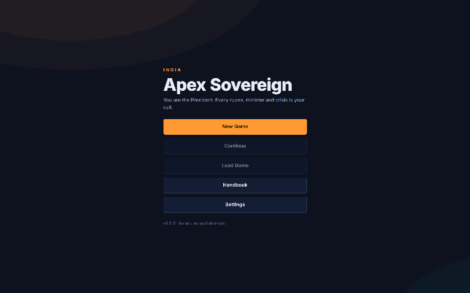

# India: Apex Sovereign

A realistic political and national strategy simulation. You are the President of India: five years, every rupee, minister, crisis, treaty and soldier, and an election at the end.

> Code name: **Power** · Status: **v1.0.0**, feature parity (Stage A) complete · Stack: TypeScript, React, Vite, Electron (Capacitor for mobile in Phase 7)



No ads, no in-app purchases, no paid shortcuts. Original name, art, text and sound.

## Play

- **Windows:** download `India-Apex-Sovereign-Setup-<version>.exe` (installer) or the portable `…-win-x64.zip` from the [Releases](https://github.com/munna7862/Power/releases) page.
- **macOS and Linux:** the same page has `.dmg`/`.zip` and `.AppImage`/`.tar.gz` builds. They are unsigned for the hobby launch: on macOS, right-click the app and choose Open the first time.
- **In a browser:** `npm ci && npm run dev`, then open http://localhost:5180.

Saves live in your user folder (`%APPDATA%\India Apex Sovereign\saves` on Windows) and survive updates and uninstalls.

## Develop

Requires Node.js 22+ (see `.nvmrc`) and Google Chrome for the end-to-end tests.

```bash
npm ci
npm run dev
```

| Command                  | What it does                                                                      |
| ------------------------ | --------------------------------------------------------------------------------- |
| `npm run dev`            | Start the game in the browser with hot reload                                     |
| `npm run electron:dev`   | Start the desktop app against the dev server                                      |
| `npm run electron:start` | Build and run the desktop app as players get it                                   |
| `npm run build`          | Production web build into `dist/`                                                 |
| `npm test`               | Unit tests (Vitest)                                                               |
| `npm run test:coverage`  | Unit tests with coverage (≥ 85% required on `src/sim`)                            |
| `npm run test:e2e`       | End-to-end tests in Google Chrome (Playwright)                                    |
| `npm run test:electron`  | Desktop smoke tests in the real Electron app (the M6 demo)                        |
| `npm run verify`         | Everything CI runs: format, lint, typecheck, tests, build and e2e                 |
| `npm run balance`        | Balance harness: 50 seeds × 5 years × 3 bots × 3 difficulties, blocking KPI bands |
| `npm run dist`           | Desktop installers for this OS into `release/` (`npm run dist:win` for Windows)   |
| `npm run screenshots`    | Release screenshots (`docs/screenshots/phase-6`) and the trailer GIF              |
| `npm run icon`           | Renders the app icon (`build/icon.png`) from `public/favicon.svg`                 |

Pushing a tag `v*` runs the [release workflow](.github/workflows/release.yml): it verifies, builds Windows, macOS and Linux installers, publishes a GitHub release with the notes in `docs/release/<tag>.md` and, if configured, pushes to itch.io.

## Project layout

| Path                   | Contents                                                                        |
| ---------------------- | ------------------------------------------------------------------------------- |
| `src/sim/`             | Pure, deterministic simulation core (no UI, no clock, seeded randomness)        |
| `content/`             | Game data as JSON (ministries, units, 205 countries, 143 events), the world map |
| `src/store/`           | Zustand bridge between the simulation and the UI                                |
| `src/platform/`        | Storage and shell adapters: browser, and the Electron bridge                    |
| `src/ui/`              | React screens, design tokens, tutorial, handbook, audio                         |
| `src/ui/i18n/`         | Every word of UI text (English; Hindi in Phase 7)                               |
| `electron/`            | Desktop main process, preload bridge and crash-safe save files                  |
| `tests/`               | Unit, architecture, save-compatibility, content-review and desktop tests        |
| `e2e/`, `e2e-desktop/` | Playwright end-to-end tests (Chrome) and desktop smoke tests (Electron)         |
| `tools/`               | Balance harness, world-data builders, release tools                             |
| `planning/`            | Master plan, phases and sprints                                                 |

Read [AGENTS.md](AGENTS.md) before contributing. Start with the [planning hub](planning/README.md) and the [master plan](planning/Master/master_plan.md). Credits and licences: [CREDITS.md](CREDITS.md). Changes: [CHANGELOG.md](CHANGELOG.md).
