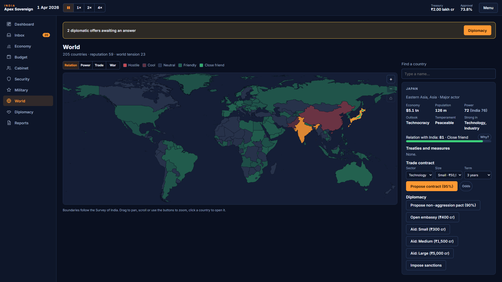

# India: Apex Sovereign

A realistic political and national strategy simulation. You are the President of India.

> Code name: **Power** · Status: Phase 5 (world map, relations, trade contracts, treaties and AI nations) · Stack: TypeScript, React, Vite (Electron for PC, Capacitor for mobile)



## Run it

Requires Node.js 22+ (see `.nvmrc`) and Google Chrome for the end-to-end tests.

```bash
npm ci
npm run dev
```

Then open http://localhost:5180.

| Command                 | What it does                                                      |
| ----------------------- | ----------------------------------------------------------------- |
| `npm run dev`           | Start the game in development mode                                |
| `npm run build`         | Production build into `dist/`                                     |
| `npm test`              | Unit tests (Vitest)                                               |
| `npm run test:coverage` | Unit tests with coverage (≥ 85% required on `src/sim`)            |
| `npm run test:e2e`      | End-to-end tests in Google Chrome (Playwright)                    |
| `npm run verify`        | Everything CI runs: format, lint, typecheck, tests, build and e2e |
| `npm run balance`       | Headless balance harness: 50 seeds × 5 years × 3 bots, KPI bands  |

## Project layout

| Path            | Contents                                                                         |
| --------------- | -------------------------------------------------------------------------------- |
| `src/sim/`      | Pure, deterministic simulation core (no UI, no clock, seeded randomness)         |
| `content/`      | Game data as JSON (ministries, units, 205 countries, 130+ events), the world map |
| `src/store/`    | Zustand bridge between the simulation and the UI                                 |
| `src/platform/` | Storage and shell adapters (browser now; Electron and Capacitor later)           |
| `src/ui/`       | React screens, design tokens and primitives                                      |
| `tests/`        | Unit, architecture and save-compatibility tests                                  |
| `e2e/`          | Playwright end-to-end tests                                                      |
| `tools/balance` | Bots and the balance harness (`npm run balance`)                                 |
| `tools/world`   | Builds the world map and `countries.json` from Natural Earth data                |
| `planning/`     | Master plan, phases and sprints                                                  |

Read [AGENTS.md](AGENTS.md) before contributing. Start with the [planning hub](planning/README.md) and the [master plan](planning/Master/master_plan.md).
