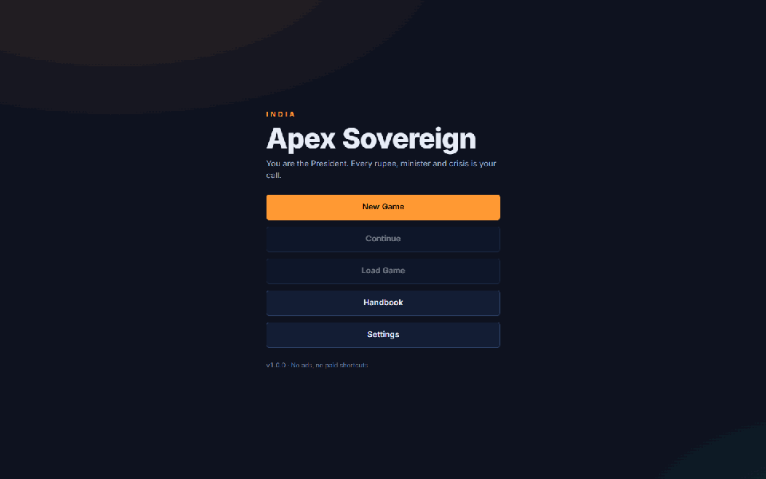

# India: Apex Sovereign

[](https://github.com/munna7862/Power/actions/workflows/ci.yml)

A political and national strategy simulation. You are the President of India for a five-year term: run the economy and the budget, fund departments, build schools and hospitals, run the power grid, industry and trade, manage police and the armed forces, deal with crises and other nations, and face an election at the end.

Code name **Power**. Desktop app built with TypeScript, React, Vite and Electron. No ads, no in-app purchases. Original name, art, text and sound.



## Status

- **v1.0.0** (tagged 2026-10-11): feature parity with the country-simulator genre, Phases 1-6. See [CHANGELOG.md](CHANGELOG.md).
- **Phase 8, Hands-on Governance**, is complete on `main` (Sprints 8.1-8.10, not yet released). It replaces the cabinet with departments that have star-rated services, and adds construction, an energy grid, industry, a trade market, an armoury, police and internal affairs, loans, a daily treasury and an advisor. Save schema is at v17.
- **Phase 7** (mobile with Capacitor, Parliament, states, Hindi, Steam) is a backlog to re-rank after launch.
- **No downloadable builds yet.** The v1.0.0 release workflow run failed on a determinism snapshot test, so the Releases page is empty. Build installers locally with `npm run dist` (see below).

## Tech stack

- TypeScript, React 19, Vite, Zustand, i18next
- Electron 44 and electron-builder (Windows, macOS, Linux)
- Zod-validated JSON game content
- Vitest (unit, architecture, save-compatibility and content tests), Playwright (end-to-end in Google Chrome, desktop smoke tests in Electron)
- ESLint, Prettier, GitHub Actions

## Run it

Requires Node.js 22+ (`.nvmrc` pins 24) and Google Chrome for the end-to-end tests.

```bash
npm ci
npm run dev              # browser, http://localhost:5180
npm run electron:start   # desktop app, production build
```

Desktop saves go to your user folder (`%APPDATA%\India Apex Sovereign\saves` on Windows), are written crash-safely and keep the last three autosaves. Saves from any earlier version keep loading (golden fixtures in `tests/fixtures/saves`).

## Commands

| Command | What it does |
| --- | --- |
| `npm run dev` | Game in the browser with hot reload |
| `npm run electron:dev` | Desktop app against the dev server |
| `npm run electron:start` | Build and run the desktop app as players get it |
| `npm run build` | Production web build into `dist/` |
| `npm test` | Unit tests (Vitest) |
| `npm run test:coverage` | Unit tests with coverage (85% or more required on `src/sim`) |
| `npm run test:e2e` | End-to-end tests in Google Chrome (Playwright) |
| `npm run test:electron` | Desktop smoke tests in the real Electron app |
| `npm run verify` | What CI runs: format, lint, typecheck, coverage, build, e2e |
| `npm run balance` | Balance harness: 50 seeds x 5 years x 3 bots x 3 difficulties against KPI bands |
| `npm run dist` | Desktop installers for this OS into `release/` (`npm run dist:win` for Windows) |
| `npm run screenshots` | Release screenshots and the trailer GIF |
| `npm run icon` | App icon from `public/favicon.svg` |

## Project structure

| Path | Contents |
| --- | --- |
| `src/sim/` | Pure, deterministic simulation core: no UI, no clock, seeded randomness |
| `content/` | Game data as JSON: departments, facilities, police, power, industries, goods, weapons, 205 countries, 144 events, the world map |
| `src/store/` | Zustand bridge between the simulation and the UI |
| `src/platform/` | Storage and shell adapters for the browser and Electron |
| `src/ui/` | React screens, design tokens, tutorial, handbook, audio; all UI text in `src/ui/i18n/` |
| `electron/` | Desktop main process, preload bridge, crash-safe save files |
| `tests/` | Unit, architecture, save-compatibility, content-review and desktop tests |
| `e2e/`, `e2e-desktop/` | Playwright tests in Chrome, and Electron smoke tests |
| `tools/` | Balance harness, world-data builders, release tools |
| `planning/` | Master plan, phases and sprints |

## CI and releases

- `.github/workflows/ci.yml` runs format check, lint, typecheck, unit tests with coverage, the web build and the Chrome end-to-end tests on every push and pull request.
- `.github/workflows/release.yml` runs on a `v*` tag: it verifies, builds Windows, macOS and Linux installers, and publishes a GitHub release with the notes from `docs/release/<tag>.md` (and pushes to itch.io if configured). macOS and Linux builds are unsigned.

## Contributing

Read [AGENTS.md](AGENTS.md) first, then the [planning hub](planning/README.md) and the [master plan](planning/Master/master_plan.md). Credits and asset licences are in [CREDITS.md](CREDITS.md).
